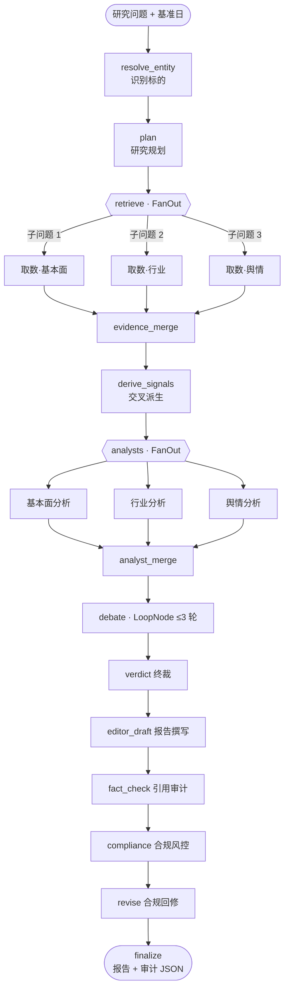
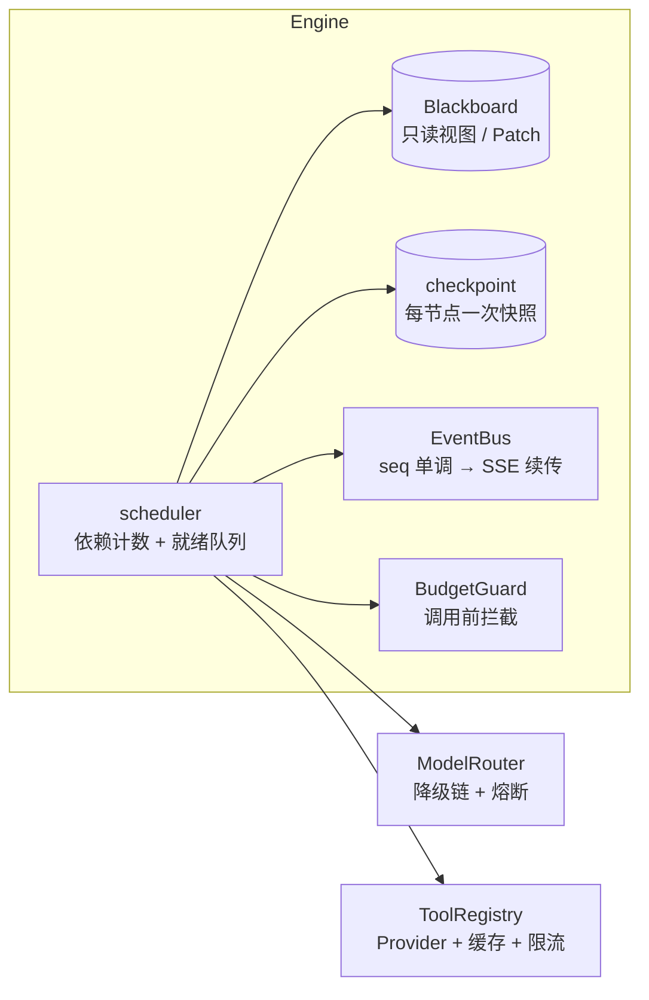

# EquityLens

An equity research generation and citation-provenance system for the China A-share market.
Given a research question and an as-of date, EquityLens orchestrates 14 nodes and 9 agent roles
to produce a Chinese-language research report in which every statement marked as fact is bound to
a source excerpt (filing, financial statement, industry data, or financial media) and can be
clicked through to the original passage in the HTML build.

[](https://github.com/markliu12/equitylens/actions/workflows/ci.yml)
[](https://codecov.io/gh/markliu12/equitylens)
[](#requirements)
[](LICENSE)

[Example report](https://markliu12.github.io/equitylens/examples/maotai-2026q3/report.html) ·
[Quick start](#quick-start) ·
[Docs](https://markliu12.github.io/equitylens/) ·
[中文说明](README.md)

---

## Contents

- [Overview](#overview)
- [Example output](#example-output)
- [Requirements](#requirements)
- [Quick start](#quick-start)
- [Configuration](#configuration)
- [Architecture](#architecture)
- [Design notes](#design-notes)
- [Testing](#testing)
- [Layout](#layout)
- [Roadmap](#roadmap)
- [Scope and disclaimers](#scope-and-disclaimers)
- [License](#license)

---

## Overview

The main obstacle to using generative models for equity research is not text quality but
verifiability: a reader cannot tell whether a statement comes from a disclosure or from the model's
own inference. EquityLens delegates the verifiable part to deterministic code and uses the model
only where summarisation and interpretation are required.

| Problem | Handling | Location |
|---|---|---|
| Unattributed figures or conclusions | Statements marked as fact must carry an `evidence_id`, and their `quote` must match the source text verbatim. Validation is three-stage deterministic code with no model involvement | `report/citations.py`, `tools/evidence.py` |
| Use of information published after the as-of date | Evidence with `published_at` later than the as-of date is discarded and recorded in the audit output | `tools/evidence.py` |
| Re-billing after an interrupted run | A checkpoint is written after each node; on resume, completed nodes are skipped and no model call is repeated | `engine/checkpoint.py` |
| Unbounded cost | `BudgetGuard` checks cost, token, and call-count ceilings before every LLM call and aborts on breach | `engine/budget.py` |
| Conflicting agent conclusions | The bull/bear debate has explicit termination conditions (round limit, novel-information ratio, score convergence); a verdict node produces cross-dimensional judgments | `agents/debate`, `agents/verdict.py` |
| Investment advice in output | A compliance node blocks buy/sell recommendations, price targets, and return promises, then re-audits after revision | `agents/risk.py` |

The system is a research-organisation tool and does not produce investment advice.
See [Scope and disclaimers](#scope-and-disclaimers).

---

## Example output


The report page shows the body text on the left and an evidence panel on the right. Citation
numbers in the body are clickable; selecting one shows the source tier (filing, financial statement,
industry data, financial media), publication time, and the original excerpt.

A [static example report](https://markliu12.github.io/equitylens/examples/maotai-2026q3/report.html)
is available without installing anything.

The example uses the synthetic dataset bundled with the repository. Figures are unrelated to any
actual financial statement, and source URLs point to `example.invalid`. Its purpose is to validate
report structure and citation behaviour offline at zero cost, not to demonstrate data accuracy.

---

## Requirements

| Item | Requirement |
|---|---|
| Python | 3.12 or later |
| Dependencies | `pip` with `pyproject.toml` (editable install) |
| Frontend build | Node.js 20 or later (only for the web UI) |
| Containers | Docker and Docker Compose (optional) |

The default `offline` mode uses the bundled fixture dataset and a deterministic offline model. It
requires no network access and no API key.

## Quick start

### Docker

```bash
# Starts the service at http://127.0.0.1:8000
docker compose up --build
```

```bash
# Or run a single CLI invocation without keeping a container
docker compose run --rm equitylens \
  python -m equitylens.cli run "分析贵州茅台最近一期经营情况与行业景气度" --offline
```

Without Docker Compose:

```bash
docker build -t equitylens .
docker run --rm equitylens python -m equitylens.cli run "分析贵州茅台" --offline
```

### Local

```bash
python -m venv .venv
source .venv/bin/activate          # Windows: .venv\Scripts\activate

pip install -e ".[dev]"
equitylens doctor                  # checks environment, configuration, and data source
equitylens run "分析贵州茅台最近一期经营情况与行业景气度" --offline
```

Output is written to `data/artifacts/<run_id>/` as `report.md`, `report.html`, and
`citation_audit.json`.

### Web UI

```bash
uvicorn equitylens.api.app:create_app --factory --host 127.0.0.1 --port 8000
```

The frontend is Vite + React + TypeScript with no UI component framework. If `web/dist` has not been
built:

```bash
cd web && npm install && npm run build
```

### Real models and real data

```bash
cp .env.example .env
```

Set `APP_MODE=dev` and configure the following variables in `.env`:

```dotenv
APP_MODE=dev
LLM_API_KEY=sk-xxx                # DeepSeek / Qwen / GLM; any OpenAI-compatible endpoint
DATA_PROVIDER=akshare             # requires pip install akshare
```

Note that the repository is Chinese-first: the A-share market, the filings, and the prompts are
Chinese, and generated reports are in Chinese. The English documentation is provided so the
architecture can be evaluated.

---

## Configuration

Configuration is supplied through environment variables or `.env`; the full list is in
`.env.example`. Commonly used settings:

| Variable | Default | Description |
|---|---|---|
| `APP_MODE` | `offline` | `offline` uses fixtures and the offline model; `dev` uses real models and data; `demo` additionally enables invite codes and hard budget limits |
| `LLM_BASE_URL` | `https://api.deepseek.com/v1` | OpenAI-compatible endpoint |
| `LLM_MODEL` | `deepseek-chat` | Primary model |
| `LLM_FALLBACK_MODELS` | `qwen-plus,glm-4-flash` | Fallback chain with a sliding-window circuit breaker |
| `BUDGET_MAX_COST_CNY` | `1.2` | Per-run cost ceiling (CNY) |
| `BUDGET_MAX_TOKENS` | `180000` | Per-run token ceiling |
| `BUDGET_MAX_LLM_CALLS` | `60` | Per-run model call ceiling |
| `DATA_PROVIDER` | `fixture` | `fixture` for bundled sample data, `akshare` for live A-share data |
| `DB_PATH` | `data/equitylens.db` | Run records and state database |

---

## Architecture

The research pipeline is wired in a single place, `graph/research_graph.py`, and consists of 14
nodes. Retrieval and analysis stages fan out in parallel; the debate stage is a loop node capped at
three rounds.

<details>
<summary>Expand: research pipeline (DAG)</summary>



</details>

<details>
<summary>Expand: engine components</summary>



</details>

---

## Design notes

### Evidence ids are content hashes

```
evidence_id = "ev_" + sha1(normalized_url + normalized_quote)[:10]
```

The same source retrieved through different channels produces the same id and is deduplicated
automatically; references remain stable across restarts, machines, and runs. During validation,
`quote` is normalised and compared against the source text so that the cited passage matches the
source.

### Derived metrics are computed before the model runs

`tools/signals.py` computes deterministic analysis inputs from raw data and passes them into the
prompt together with their `basis` (the formula actually used), instructing the model to cite rather
than recompute. Models recomputing financial ratios is a significant source of numeric error.
Moving the arithmetic into code makes repeated runs over the same data produce identical results and
allows unit tests to cover the logic.

| Derived quantity | Formula | Purpose |
|---|---|---|
| `growth_vs_industry` | company revenue growth − industry output growth | Distinguish share gains from industry upcycle |
| `growth_divergence` | quarterly YoY − full-year YoY | Detect a mid-year change in momentum |
| `cash_to_profit` | operating cash flow ÷ net income | Measure the cash content of profit |
| `contract_liability_growth` | growth in contract liabilities since year start | Indicate order visibility |

### Core conclusions must be cross-dimensional

The core-conclusions section tends to degenerate into a restatement of the detail sections. The
system constrains it: each conclusion must reference evidence from at least two independent sources
and must contain a judgment rather than a metric restatement. The constraint is asserted in
`tests/unit/test_report_quality.py`; a regression fails the suite.

```text
Industry output -3.2% YoY against company revenue +15.6% YoY, a gap of 18.8 pp.
The relationship indicates growth came from share gains rather than an industry recovery, so the
competitive landscape, not a demand cycle, is the variable to monitor.
```

### The engine has no business knowledge

`engine/` is a pure asyncio orchestration core with no LLM or tool-implementation dependencies. It
provides dependency-count scheduling, cross-layer pipelining, separated semaphores for LLM, tool,
and domain capacity, Patch and reducer merge semantics, checkpoint snapshots, and event streaming.
All external capability is injected through `Services`, so changing data source, model, or domain
requires no engine changes, and the engine is testable in isolation.

---

## Testing

```bash
pytest -q --cov=src/equitylens                # 124 passed, 80% coverage
ruff check src tests evals                    # 0 errors
mypy                                          # 0 errors (engine / agents.schemas / llm / tools / tools.signals)
python evals/run_eval.py --label baseline     # 25 questions total; only the 5 offline ones run by default
                                              # result: coverage 1.00, hit 1.00, leaks 0
```

The figures above are from the current `main` branch and are re-run by CI on every push.

### Engine assertions

- Full execution of a diamond-shaped DAG, cycle detection, unknown dependencies, and writes to
  unauthorised channels;
- FanOut over four subtasks completes in under 60% of the serial duration;
- After crash recovery, completed nodes make zero model calls and the final state matches a single
  uninterrupted run;
- Cancellation reaches a terminal state within one second, with incomplete nodes marked `CANCELLED`;
- SSE `Last-Event-ID` resumption, idempotency keys, and 404 / 409 / 422 boundaries.

### Content-shape assertions

`tests/unit/test_report_quality.py` contains eight gates that constrain the shape of the report
content:

- no conclusion may appear in two sections;
- core conclusions must contain a judgment, not a restated metric;
- each core conclusion must reference at least two sources;
- statements marked as fact must carry a citation;
- the bull/bear section must contain rebuttal structure;
- the summary must contain verifiable quantitative statements.

These gates target output that passes schema validation and citation-coverage checks while remaining
substantively weak, which format validation alone cannot detect.

---

## Layout

```text
src/equitylens/
├─ engine/     Orchestration engine (no LLM or tool dependencies)
├─ llm/        OpenAI-compatible client, model router, structured output repair, offline model
├─ agents/     Nine roles: planner, retriever, 3 analysts, bull/bear/judge, verdict, risk, editor
├─ tools/      Provider protocol, fixture, akshare, evidence chain, derived metrics, cache, limiter
├─ graph/      Single wiring point for the research DAG
├─ report/     Citation audit and Markdown / HTML rendering
├─ api/        FastAPI + SSE + run management
└─ fixtures/   Bundled dataset (synthetic)

web/           Vite + React + TypeScript frontend
tests/         124 cases: unit, integration, offline end-to-end, content-quality gates
evals/         25-question eval set, deterministic metrics, paired bootstrap A/B
docs/          Architecture notes, engine design, ADRs, example output
```

---

## Roadmap

- [x] Orchestration engine: scheduling, checkpointing, resume, fallback, budget, event stream
- [x] Nine agent roles, bull/bear debate, compliance controls
- [x] Mandatory citation provenance and audit JSON
- [x] FastAPI + SSE + React frontend, offline fixture end-to-end
- [x] akshare data source (provider, fixture fallback, contract tests)
- [x] Derived metric layer, cross-dimensional conclusions, content-quality gates
- [x] 25-question eval set, deterministic metrics runner, paired bootstrap A/B
- [ ] Cninfo announcement integration
- [ ] Public deployment (replay mode, invite codes, daily budget)
- [ ] Extract `engine/` into a standalone package with a non-financial minimal example

---

## Scope and disclaimers

This project is intended for technical study and research information organisation. It does not
constitute investment advice, an offer, or a commitment of any kind. The system produces research
summaries only; the compliance node blocks buy/sell recommendations, price targets, and return
promises.

Reports are generated automatically. Data may be delayed, incomplete, or inaccurate, and cited
content should be verified against the original source. The bundled dataset is synthetic and must
not be cited as real disclosure.

## License

[MIT](LICENSE)

---

[中文说明](README.md) · [Contributing](CONTRIBUTING.md) · [Docs](https://markliu12.github.io/equitylens/) · [Data sources](https://markliu12.github.io/equitylens/data-sources/)
