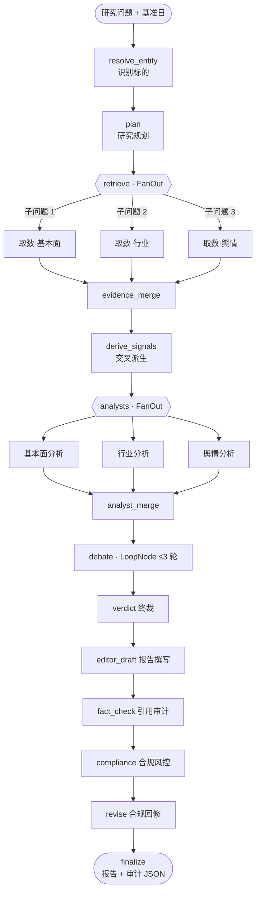
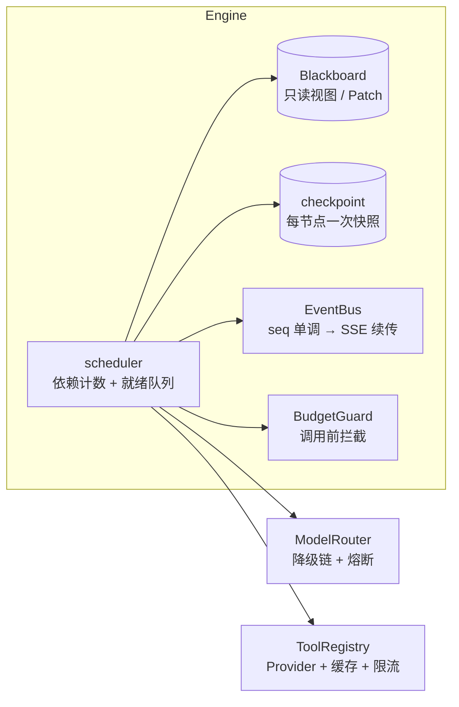

# EquityLens 研镜

面向 A 股的研报生成与引用溯源系统。输入一个研究问题与基准日期，系统编排 14 个节点、9 类 Agent
生成中文研究报告；报告中标注为事实的陈述均绑定到原始证据（公告、财报、行业数据、财经媒体），
可在 HTML 版本中逐条回跳至原文片段。

[](https://github.com/markliu12/equitylens/actions/workflows/ci.yml)
[](https://codecov.io/gh/markliu12/equitylens)
[](#环境要求)
[](LICENSE)

[示例报告](https://markliu12.github.io/equitylens/examples/maotai-2026q3/report.html) ·
[快速开始](#快速开始) ·
[文档站](https://markliu12.github.io/equitylens/) ·
[English README](README.en.md)

---

## 目录

- [概述](#概述)
- [示例产出](#示例产出)
- [快速开始](#快速开始)
- [配置](#配置)
- [系统结构](#系统结构)
- [关键机制](#关键机制)
- [测试与质量](#测试与质量)
- [目录结构](#目录结构)
- [路线图](#路线图)
- [使用须知](#使用须知)
- [License](#license)

---

## 概述

生成式模型用于研究报告时，落地的主要障碍在于可核验性：读者无法判断某一句结论
来自原始披露，还是模型自行推断。EquityLens 的处理方式是把可核验的部分交给确定性代码，
只在需要归纳与解释的环节使用模型。

具体约束如下：

| 问题 | 处理方式 | 实现位置 |
|---|---|---|
| 数字或结论来源不明 | 标注为事实的陈述必须携带 `evidence_id`，其 `quote` 须在证据原文中逐字命中；校验为三级确定性代码，不调用模型 | `report/citations.py`、`tools/evidence.py` |
| 使用了基准日期之后的信息 | 证据的 `published_at` 晚于研究基准日期时丢弃，并记入审计输出 | `tools/evidence.py` |
| 任务中断导致重复计费 | 每个节点完成后写入 checkpoint；恢复时跳过已成功节点，不重复调用模型 | `engine/checkpoint.py` |
| 成本不可控 | `BudgetGuard` 在每次 LLM 调用前校验金额、token、调用次数三项上限，超限中止 | `engine/budget.py` |
| 多 Agent 结论冲突 | 多空辩论设有显式终止条件（轮数上限、新增信息比例、得分收敛），由终裁节点输出跨维度交叉判断 | `agents/debate`、`agents/verdict.py` |
| 输出涉投资建议 | 合规节点拦截买卖建议、目标价、收益承诺类表述，回修后重新审计 | `agents/risk.py` |

系统定位是研究信息整理工具，不产出投资建议，详见[使用须知](#使用须知)。

---

## 示例产出


报告页左侧为正文，右侧为证据链面板。正文中的引用编号可点击，点击后在面板中显示对应来源的分级
（公告 / 财报 / 行业数据 / 财经媒体）、发布时间与原文片段。

无需安装即可查看[静态示例报告](https://markliu12.github.io/equitylens/examples/maotai-2026q3/report.html)。

示例使用仓库内置的合成数据集，数值与真实财报无关，来源 URL 指向 `example.invalid`。
其用途是在无网络、无 API 费用的条件下验证报告结构与引用逻辑，不用于评估数据准确性。

---

## 快速开始

### 环境要求

| 项目 | 要求 |
|---|---|
| Python | 3.12 及以上 |
| 依赖管理 | `pip` + `pyproject.toml`（可编辑安装） |
| 前端构建 | Node.js 20 及以上（仅构建 Web 界面时需要） |
| 容器 | Docker 及 Docker Compose（可选） |

默认的 `offline` 模式使用本地 fixture 数据与确定性离线模型，不访问外网，无需 API Key。

### Docker

```bash
# 启动服务，访问 http://127.0.0.1:8000
docker compose up --build
```

```bash
# 或仅执行一次 CLI，不保留容器
docker compose run --rm equitylens \
  python -m equitylens.cli run "分析贵州茅台最近一期经营情况与行业景气度" --offline
```

未安装 Docker Compose 时可直接使用镜像：

```bash
docker build -t equitylens .
docker run --rm equitylens python -m equitylens.cli run "分析贵州茅台" --offline
```

### 本地运行

```bash
python -m venv .venv
source .venv/bin/activate          # Windows: .venv\Scripts\activate

pip install -e ".[dev]"
equitylens doctor                  # 自检环境、配置与数据源可用性
equitylens run "分析贵州茅台最近一期经营情况与行业景气度" --offline
```

运行结果写入 `data/artifacts/<run_id>/`，包含 `report.md`、`report.html` 与 `citation_audit.json`。

### Web 界面

```bash
uvicorn equitylens.api.app:create_app --factory --host 127.0.0.1 --port 8000
```

前端为 Vite + React + TypeScript，未引入 UI 组件框架。若 `web/dist` 尚未构建：

```bash
cd web && npm install && npm run build
```

### 使用真实模型与数据源

```bash
cp .env.example .env
```

在 `.env` 中配置以下变量后，将 `APP_MODE` 设为 `dev`：

```dotenv
APP_MODE=dev
LLM_API_KEY=sk-xxx                # DeepSeek / 通义 / 智谱，需兼容 OpenAI 协议
DATA_PROVIDER=akshare             # 需先 pip install akshare
```

---

## 配置

配置通过环境变量或 `.env` 提供，完整列表见 `.env.example`。常用项：

| 变量 | 默认值 | 说明 |
|---|---|---|
| `APP_MODE` | `offline` | `offline` 使用 fixture 与离线模型；`dev` 使用真实模型与数据；`demo` 额外启用邀请码与预算硬约束 |
| `LLM_BASE_URL` | `https://api.deepseek.com/v1` | OpenAI 兼容接口地址 |
| `LLM_MODEL` | `deepseek-chat` | 主模型 |
| `LLM_FALLBACK_MODELS` | `qwen-plus,glm-4-flash` | 降级链，主模型失败时按序尝试，带滑动窗口熔断 |
| `BUDGET_MAX_COST_CNY` | `1.2` | 单次研究的成本上限（元） |
| `BUDGET_MAX_TOKENS` | `180000` | 单次研究的 token 上限 |
| `BUDGET_MAX_LLM_CALLS` | `60` | 单次研究的模型调用次数上限 |
| `DATA_PROVIDER` | `fixture` | `fixture` 为本地示例数据；`akshare` 为真实 A 股数据 |
| `DB_PATH` | `data/equitylens.db` | 运行记录与状态数据库 |

---

## 系统结构

研究流程由 `graph/research_graph.py` 统一装配，共 14 个节点。取数与分析阶段使用 FanOut 并行，
辩论阶段为最多 3 轮的循环节点。

<details>
<summary>展开：研究流程（DAG）</summary>



</details>

<details>
<summary>展开：引擎内部组件</summary>



</details>

---

## 关键机制

### 引用溯源基于内容哈希

```
evidence_id = "ev_" + sha1(规范化 url + 规范化片段)[:10]
```

同一来源从不同渠道抓取时生成相同 id，可自动去重；跨运行、跨机器的引用保持一致。
校验阶段对 `quote` 做归一化后与证据原文比对，确保引用文本与来源实际一致。

### 派生指标先于模型计算

`tools/signals.py` 由原始数据计算确定性的分析素材，随 `basis`（计算式）一并写入提示词，
要求模型直接引用而不再自行推算。模型自行计算财务指标是数值偏差的主要来源之一，
将这部分移入代码后，同一份数据每次运行得到相同结果，并可由单元测试覆盖。

| 派生量 | 计算式 | 用途 |
|---|---|---|
| `growth_vs_industry` | 公司营收增速 − 行业产量增速 | 区分增长来自份额提升还是行业景气 |
| `growth_divergence` | 单季同比 − 全年同比 | 判断年内动能是否切换 |
| `cash_to_profit` | 经营现金流 ÷ 净利润 | 衡量利润的现金含量 |
| `contract_liability_growth` | 合同负债较年初增速 | 反映订单能见度 |

### 核心结论要求交叉判断

报告的核心结论章节容易退化为明细章节的摘要复述。系统对该章节施加约束：每条结论至少关联
两个不同来源的证据，且须包含判断性表述。约束由 `tests/unit/test_report_quality.py` 断言，
不满足即测试失败。

```text
行业产量同比 -3.2%，公司营收同比 +15.6%，高出 18.8 个百分点。
该组关系表明增长主要来自份额提升而行业景气未回暖，后续应关注竞争格局变化，
而非等待需求周期反转。
```

### 引擎与业务解耦

`engine/` 是不依赖 LLM 与工具实现的纯 asyncio 编排内核，包含依赖计数调度、跨层流水线、
三类信号量分离（LLM / 工具 / 域名）、Patch 与 reducer 合并语义、checkpoint 快照与事件流。
外部能力统一通过 `Services` 注入，更换数据源、模型或行业领域时无需修改引擎，引擎亦可独立测试。

---

## 测试与质量

```bash
pytest -q --cov=src/equitylens                # 124 passed，覆盖率 80%
ruff check src tests evals                    # 0 error
mypy                                          # 0 error（engine / agents.schemas / llm / tools / tools.signals）
python evals/run_eval.py --label baseline     # 评测集共 25 题，默认只跑其中 5 道离线题
                                              # 结果：coverage 1.00 / hit 1.00 / leaks 0
```

上述数值为当前 `main` 分支的运行结果，CI 在每次推送时重新执行。

### 引擎层断言

- 钻石型 DAG 全节点执行、环检测、未知依赖与越权写通道；
- FanOut 4 个子任务并行耗时低于串行耗时的 60%；
- 崩溃恢复后已完成节点的模型调用次数为 0，最终状态与单次完整运行一致；
- 取消后 1 秒内进入终态，未完成节点标记为 `CANCELLED`；
- SSE `Last-Event-ID` 续传、幂等键及 404 / 409 / 422 边界。

### 内容层断言

`tests/unit/test_report_quality.py` 共 8 项门禁，约束报告的内容形态：

- 同一结论不得重复出现在两个章节；
- 核心结论须包含判断性表述，不得为指标复述；
- 每条核心结论至少关联 2 个来源；
- 标注为事实的结论必须携带引用；
- 多空分歧须包含反驳结构；
- 摘要须包含可核验的数量描述。

这些断言针对的是通过 schema 校验、引用覆盖率正常但内容不达标的输出，
仅有格式校验无法覆盖该情形。

---

## 目录结构

```text
src/equitylens/
├─ engine/        编排引擎（不依赖 LLM 与工具实现）
├─ llm/           OpenAI 兼容客户端 / 模型路由 / 结构化输出修复 / 离线确定性模型
├─ agents/        9 类 Agent：规划、取数、3 名分析师、多空辩论、裁判、终裁、风控、主编
├─ tools/         Provider 协议 / fixture / akshare / 证据链 / 派生指标 / 缓存 / 限流
├─ graph/         研究 DAG 装配入口
├─ report/        引用审计与 Markdown / HTML 渲染
├─ api/           FastAPI + SSE + 运行管理
└─ fixtures/      示例数据集（合成数据）

web/              Vite + React + TypeScript 前端
tests/            单元、集成、离线端到端与内容质量门禁共 124 个用例
evals/            25 题评测集、确定性指标与配对 bootstrap A/B
docs/             架构说明、引擎设计、ADR 与示例产出
```

---

## 路线图

- [x] 编排引擎：调度、checkpoint、恢复、降级、预算与事件流
- [x] 9 类 Agent、多空辩论与合规风控
- [x] 强制引用溯源与审计 JSON
- [x] FastAPI + SSE + React 前端与离线 fixture 全链路
- [x] akshare 数据源（Provider、fixture 降级与契约测试）
- [x] 派生指标层、交叉结论约束与内容质量门禁
- [x] 25 题评测集、确定性指标运行器与配对 bootstrap A/B
- [ ] 巨潮公告接入
- [ ] 公网部署（回放模式、邀请码、日预算）
- [ ] 将 `engine/` 拆分为独立包，并提供非金融场景的最小示例

---

## 使用须知

本项目仅用于技术学习与研究信息整理，不构成任何投资建议、要约或承诺。系统只产出研究信息整理结果，
合规节点会拦截买卖建议、目标价与收益承诺类表述。

报告由模型自动生成，数据可能存在延迟、缺失或误差，引用内容以原始出处为准。
仓库内置示例数据集为合成数据，不可作为真实披露信息引用。

## License

[MIT](LICENSE)

---

[English README](README.en.md) · [贡献指南](CONTRIBUTING.md) · [文档站](https://markliu12.github.io/equitylens/) · [数据源说明](https://markliu12.github.io/equitylens/data-sources/)
