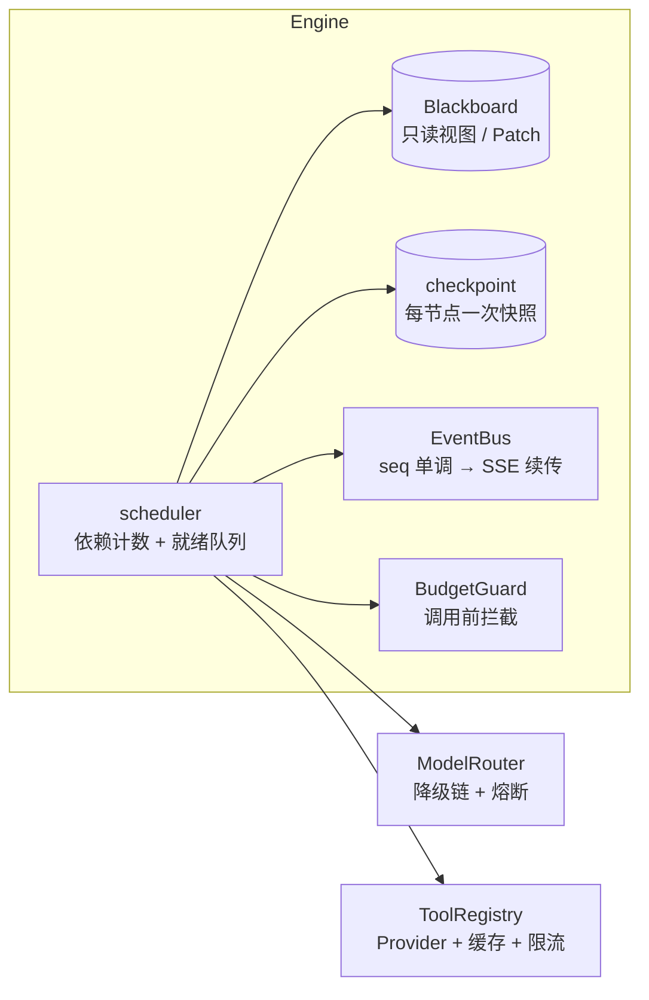

# EquityLens 研镜

> **每条结论都能点回原文的 A 股研究报告系统。**

给定一个研究问题，9 类 Agent 跑完 14 个编排节点，产出一份中文研究报告。
报告里每一个数字、每一条判断，都能点开看到它来自哪份公告的哪一句话。

[](https://github.com/markliu12/equitylens/actions/workflows/ci.yml)
[](#质量)
[](#质量)
[](#五分钟跑通)
[](LICENSE)

[看一份真实产出](docs/examples/maotai-2026q3/report.html) · [五分钟跑通](#五分钟跑通) · [设计取舍](docs/engine-design.md)

---

## 先看产出


左侧是正文，右侧是证据链。**引用编号可点击**，点一下跳到对应来源，显示来源分级
（公告 / 财报 / 行业数据 / 财经媒体）、发布时间和原文片段。

不想装任何东西？直接打开 [静态示例报告](docs/examples/maotai-2026q3/report.html) 点几下引用试试。

> 示例用的是仓库内置的合成数据集，数值与真实财报无关，URL 指向 `example.invalid`。
> 它存在的目的是让你在零网络、零费用的条件下验证**结构与逻辑**，而不是看数字好不好看。

---

## 它解决什么问题

AI 写研报，最大的问题从来不是"写得不够好"，而是**你不敢用**。

| 你心里的顾虑 | 这里的做法 |
|---|---|
| "这个数字是它编的吗？" | 声明为"事实"的结论**必须**挂 `evidence_id`，且 `quote` 必须能在原文里逐字找到。三级校验全是确定性代码，不依赖模型 |
| "它是不是用了当时还没发生的信息？" | 证据的 `published_at` 晚于研究基准日 → 直接丢弃并记入审计。防前视偏差是默认行为，不是最佳实践 |
| "跑一半断了，钱是不是白花了？" | 每个节点完成写一次快照。恢复时已成功的节点直接跳过——实测崩在中途重启后，已完成节点的模型调用次数为 **0** |
| "会不会月底看到一张天价账单？" | `BudgetGuard` 在**每次** LLM 调用**之前**检查成本 / token / 调用次数三重上限，超限即中止 |
| "两个 Agent 说的不一样，信谁？" | 多空辩论有显式终止条件（轮数上限 / 新增信息比例 / 得分收敛），终裁负责产出**跨维度交叉判断**，而不是挑一句好听的话 |
| "报告会不会给我投资建议？" | 合规节点拦截买卖建议、目标价、收益承诺类表述；回修后重新审计 |

一句话：**它不是一个更会说话的模型，是一套让你能验证它有没有说错的机制。**

---

## 五分钟跑通

### 方式一：Docker

```bash
# 起服务，打开 http://127.0.0.1:8000
docker compose up --build

# 或者只跑一次 CLI，不留容器
docker compose run --rm equitylens \
  python -m equitylens.cli run "分析贵州茅台最近一期经营情况与行业景气度" --offline
```

没有 `docker compose` 也能用：

```bash
docker build -t equitylens .
docker run --rm equitylens python -m equitylens.cli run "分析贵州茅台" --offline
```

### 方式二：本地（四条命令）

```bash
python -m venv .venv && source .venv/bin/activate   # Windows: .venv\Scripts\activate
pip install -e ".[dev]"
equitylens doctor                                   # 自检：环境、配置、数据源
equitylens run "分析贵州茅台最近一期经营情况与行业景气度" --offline
```

默认 **offline 模式**：本地 fixture 数据 + 确定性离线模型，**零外网、零费用**，
不需要任何 API Key。报告写到 `data/artifacts/<run_id>/`（`report.md` / `report.html` / `citation_audit.json`）。

### 方式三：起服务看界面

```bash
uvicorn equitylens.api.app:create_app --factory --host 127.0.0.1 --port 8000
# 打开 http://127.0.0.1:8000
```

前端是 Vite + React + TS，**没有 UI 框架**，手写 CSS（663 行）。若未构建，先 `cd web && npm i && npm run build`。

### 换成真实模型和真实数据

```bash
cp .env.example .env
# APP_MODE=dev
# LLM_API_KEY=sk-xxx          # DeepSeek / 通义 / 智谱 均可，OpenAI 兼容协议
# DATA_PROVIDER=akshare       # 需 pip install akshare
```

单次研究的成本上限由 `BUDGET_MAX_COST_CNY`（默认 1.2 元）控制，
真实模型的降级链是 `deepseek-chat → qwen-plus → glm-4-flash`，带滑动窗口熔断。

---

## 核心设计

### 1. 证据链用内容哈希，不是自增 id

```
evidence_id = "ev_" + sha1(规范化 url + 规范化片段)[:10]
```

同一篇新闻从两个渠道抓到，id 相同，自动去重；重启、换机器、跨运行引用都对得上。
`quote` 归一化后必须能在证据原文里找到——这条检查让"看起来有引用"变成"真的能对上"。

### 2. 派生信号层：先算数，再让模型解释

`tools/signals.py` 把原始数据交叉成**确定性**的判断素材：

| 派生量 | 算式 | 用途 |
|---|---|---|
| `growth_vs_industry` | 公司营收增速 − 行业产量增速 | 判断增长来自份额还是景气 |
| `growth_divergence` | 单季同比 − 全年同比 | 判断动能在年内是否切换 |
| `cash_to_profit` | 经营现金流 ÷ 净利润 | 判断利润的现金含量 |
| `contract_liability_growth` | 合同负债较年初增速 | 订单能见度 |

这些数字连带 `basis`（算式）一起进 prompt，**要求模型直接引用、不许自行重算**。
模型自行推算财务数据是幻觉的主要来源；把它挪进确定性代码后，同一份数据每次跑出同样的结论，
而且可以写单测锁住。

### 3. 核心结论必须是交叉判断

报告里最容易被做假的一节是"核心结论"：把明细章节的前三条抄一遍，看起来很像那么回事。
这里的约束是**每条核心结论至少挂 2 个不同来源的证据**：

> 行业产量同比 -3.2%，公司营收同比 +15.6%，高出 18.8 个百分点。
> 这组关系说明增长的主要来源是份额提升，而不是行业景气回暖；
> 因此后续该盯的是竞争格局有没有变化，而不是等需求周期。

这条约束由 `tests/unit/test_report_quality.py` 强制，回退就红。

### 4. 引擎不认识业务

`engine/` 是 10 个模块、零 LLM / 零工具依赖的纯 asyncio 编排内核：依赖计数调度、
跨层流水线、三类信号量分离（LLM / 工具 / 域名）、Patch + reducer 的合并语义、
checkpoint 快照、事件流。所有外部能力通过 `Services` 注入。

这意味着换数据源、换模型、换行业，引擎一行都不用改——也能被单独测试。

---

## 架构

<details>
<summary>展开：DAG 结构（14 个节点）</summary>


</details>

<details>
<summary>展开：引擎内部机制</summary>



</details>

---

## 质量

```bash
pytest -q --cov=src/equitylens        # 124 passed, 80% coverage
ruff check src tests evals            # 0 error
mypy                                  # 0 error（engine / agents.schemas / llm / tools / tools.signals）
python evals/run_eval.py --label baseline   # 离线 5 题：coverage 1.00 / hit 1.00 / leaks 0
```

### 被测试锁住的关键约束

**引擎层**

- 钻石型 DAG 全节点执行、环检测、未知依赖、越权写通道；
- FanOut 4 个子任务并行耗时 < 串行的 60%；
- 崩溃恢复后已完成节点的模型调用次数为 **0**，最终状态与一次跑到底完全一致；
- 取消后 1s 内进入终态，未完成节点标记 `CANCELLED`；
- SSE `Last-Event-ID` 续传、幂等键、404/409/422 边界。

**内容层**（`tests/unit/test_report_quality.py`，8 项门禁）

- 同一结论不得出现在两个章节（旧实现里核心结论与基本面章节结构性重复）；
- 核心结论必须含判断性表述，不得是"XX 为 YY"的指标转述；
- 每条核心结论至少挂 2 个来源，否则不构成交叉判断；
- 标为"事实"的结论必须有引用；
- 多空分歧必须含反驳结构，不能是结论加前缀复述；
- 摘要必须含可核验的数量描述，不得用"综合三方分析"收尾。

这几条断言拦的都是**能跑通、schema 合法、引用覆盖率还很好看**的错误——
只有靠内容形态断言才拦得住。

---

## 目录结构

```
src/equitylens/
├─ engine/        自研编排引擎（10 模块，不含任何 LLM / 工具依赖）
├─ llm/           OpenAI 兼容客户端 / 模型路由 / 结构化输出修复 / 离线确定性模型
├─ agents/        9 类 Agent（规划、取数、3 分析师、多空辩论、裁判、终裁、风控、主编）
├─ tools/         Provider 协议 / fixture / akshare / 证据链 / 派生信号 / 缓存 / 限流
├─ graph/         研究 DAG 的唯一装配点
├─ report/        引用审计 + Markdown / HTML 渲染
├─ api/           FastAPI + SSE + 运行管理
└─ fixtures/      示例数据集（合成数据）
web/              Vite + React + TS（无 UI 框架，手写 CSS）
tests/            124 个测试：单元 + 集成 + 离线端到端 + 内容质量门禁
evals/            25 题评测集 + 确定性指标 + 配对 bootstrap A/B
docs/             架构 / 引擎设计 / ADR / 示例产出
```

---

## 使用边界

**不做投资建议。** 系统只产出研究整理，合规节点会拦截买卖建议、目标价、收益承诺类表述。
示例数据集为合成数据，请勿引用为真实披露信息。

## 路线图

- [x] 编排引擎（调度 / checkpoint / 恢复 / 降级 / 预算 / 事件）
- [x] 9 类 Agent + 多空辩论 + 合规风控
- [x] 强制引用溯源 + 审计 JSON
- [x] FastAPI + SSE + React 前端 + 离线 fixture 全链路
- [x] 真实数据源 akshare（Provider + fixture 降级 + 契约测试）
- [x] 派生信号层 + 交叉判断 + 内容质量门禁
- [x] 25 题评测集 + 确定性指标运行器 + 配对 bootstrap A/B
- [ ] 巨潮公告接入
- [ ] 公网部署（回放模式 + 邀请码 + 日预算）
- [ ] 把 `engine/` 抽成独立包，非金融场景的最小示例

## 免责声明

本项目仅用于技术学习与研究信息整理，**不构成任何投资建议、要约或承诺**。
报告由 AI 自动生成，数据可能存在延迟、缺失或误差，引用内容以原始出处为准。

## License

[MIT](LICENSE)

---

<sub>[English README](README.en.md) · [贡献指南](CONTRIBUTING.md) · [数据源说明](docs/data-sources.md)</sub>
