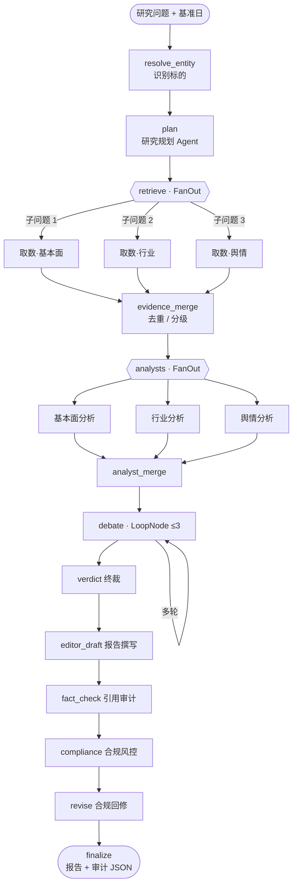
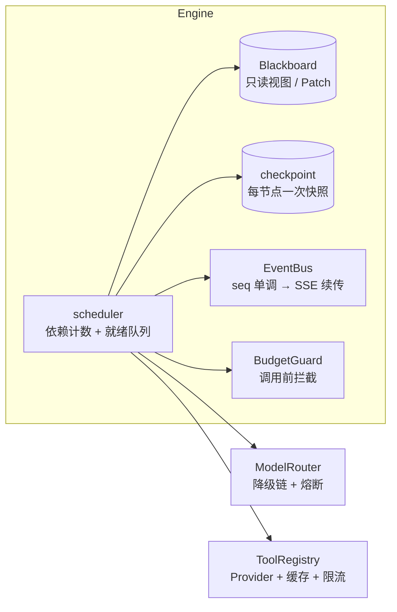
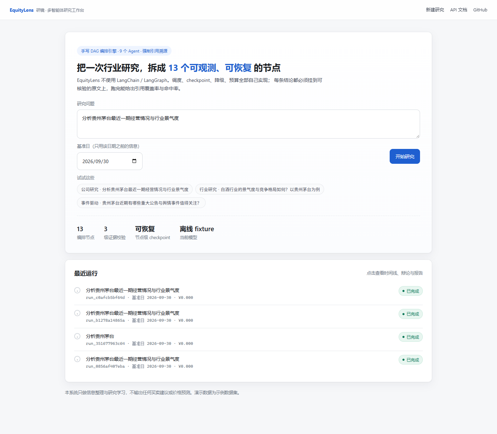
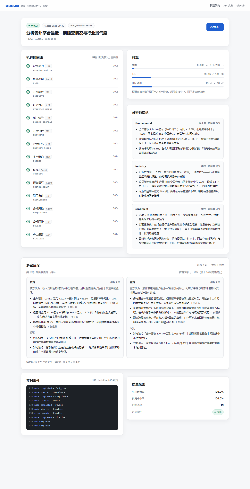
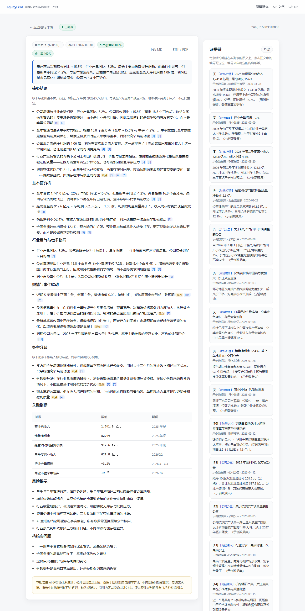

# EquityLens 研镜

> **不依赖 LangChain / LangGraph，手写 DAG 编排引擎的行业研究多智能体系统。**
> 每条结论强制挂 `evidence_id`，全程可 checkpoint、可断点恢复、可回放、可评测、成本可控。

[](https://github.com/markliu12/equitylens/actions/workflows/ci.yml)
[](#测试)
[](#测试)
[](#快速开始)
[](LICENSE)

---

## 这是什么

把一个研究问题（例如"分析贵州茅台最近一期经营情况与行业景气度"）交给 9 个 Agent，
经过 **13 个编排节点**产出可溯源的中文研究报告：

```
识别标的 → 研究规划 → 并行取数 → 证据合并
  → 并行分析（基本面 / 行业 / 舆情）→ 分析汇总
  → 多空辩论（≤3 轮，三重终止条件）
  → 终裁 → 报告撰写 → 引用审计 → 合规风控 → 合规回修 → 产出报告
```

**与"套壳 Agent Demo"的区别在于四个工程问题被真正解决了：**

| 问题 | 本项目的做法 |
|---|---|
| 多 Agent 并行写状态互相污染 | Blackboard + 只读视图 + 声明式 Patch/reducer，写权限在构建期校验 |
| 跑到一半崩了要重来（重复烧钱） | 节点级 checkpoint，恢复时已完成节点不再调用模型 |
| 报告看起来有引用、实际对不上原文 | `evidence_id` 内容哈希 + quote 必须命中原文 + 前视偏差检查 |
| 线上被刷爆 API 额度 | 每次模型调用**之前**检查预算，超限直接中止 |

---

## 架构



引擎内部机制：



---

## 界面

| 新建研究 | 运行详情（时间线 / 辩论 / 预算） |
|---|---|
|  |  |

报告页：左侧正文的引用编号可点击定位，右侧是证据链（含来源分级、发布时间、原文片段）：



---

## 核心设计

### 1. 自研编排引擎：调度、状态、恢复

- **状态模型**：节点拿到的是深拷贝只读视图，写只能通过 `Patch`，且只能写自己声明的通道；
  合并语义由 reducer 显式声明（`append` / `append_unique` / `merge_map` / `sum_usage`）。
  并行节点写同一通道不会因为完成顺序不同而结果不同。
- **调度**：依赖计数而非"拓扑排序逐层执行"，允许跨层流水线；三类信号量（LLM / 工具 / 域名）分离，
  避免慢工具饿死 LLM 槽位。
- **恢复**：每节点完成写一次快照（状态 < 200KB），恢复时已 `SUCCEEDED` 的节点直接跳过。
  实测：崩在 n3 后续跑，n1/n2 的模型调用次数为 **0**，最终状态与一次跑到底完全一致（有单测断言）。

### 2. 可审计的证据链

- `evidence_id = "ev_" + sha1(规范化 url + 规范化片段)[:10]` —— 内容哈希而非自增 id，
  同一条新闻从两个渠道抓到 id 相同，自动去重；重启、换机器后引用仍然对得上。
- 三级校验（全部确定性代码，不依赖模型）：
  1. 声明为"事实"的结论必须有 `evidence_ids`；
  2. id 必须存在于本次运行的证据集合；
  3. `quote` 归一化后必须能在证据原文里找到 —— 同时检查 `published_at <= as_of`，防前视偏差。
- 输出 `citation_audit.json`，把"引用覆盖率 / 命中率"变成可以卡 CI 的门禁指标。

### 3. 成本与稳定性

- `BudgetGuard.check()` 在**每次 LLM 调用前**执行（成本 / token / 调用次数三重上限），
  超限抛 `BUDGET` 失败并中止，而不是月底看账单。
- 模型降级链 `deepseek-chat → qwen-plus → glm-4-flash` + 滑动窗口熔断（连续失败 60s 内不再尝试）。
- 降级语义按角色定义：分析师产出"数据不足"的合法报告、裁判退化为规则打分、
  报告撰写失败则不降级（宁可不交付，也不交付残次品）。

---

## 与灵感来源的差异

项目结构上参考了 [TradingAgents](https://github.com/TauricResearch/TradingAgents)（11.1 万 star）
的"分析师并行 → 多空辩论 → 风控 → 组合经理"思路。**未复制其任何源码**，实现层面有六处刻意不同：

| 维度 | TradingAgents | EquityLens |
|---|---|---|
| 编排 | LangGraph 图 + checkpointer | 自研 DAG 引擎（调度 / 状态 / checkpoint / 降级全部自己写） |
| 状态 | LangGraph State（TypedDict + reducer） | Blackboard + 只读视图 + 写权限校验 |
| 领域 | 美股为主，交易决策 | A 股行业研究，明确**不做交易决策** |
| 引用 | 报告引用数据源 | `evidence_id` 内容哈希 + quote 命中校验 + 前视偏差检查 |
| 成本 | 无硬预算 | 调用前预算拦截 + 降级链 + 熔断 |
| 可复现 | LLM 采样不可复现 | 离线确定性模型 + fixture，CI 可断言 |

---

## 快速开始

### 1. 后端

```bash
python -m venv .venv
# Windows: .venv\Scripts\activate
source .venv/bin/activate
pip install -e ".[dev]"
```

### 2. 前端（可选，构建后由后端托管）

```bash
cd web
npm install
npm run build
cd ..
```

### 3. 跑一次（默认离线模式，零外网零费用）

```bash
# 命令行
equitylens run "分析贵州茅台最近一期经营情况与行业景气度"

# 或者起服务
uvicorn equitylens.api.app:create_app --factory --host 127.0.0.1 --port 8000
# 打开 http://127.0.0.1:8000
```

### 4. 接真实模型

```bash
cp .env.example .env
# 编辑 .env：
#   APP_MODE=dev
#   LLM_API_KEY=sk-xxx          （DeepSeek / 通义 / 智谱 均可，OpenAI 兼容协议）
#   LLM_MODEL=deepseek-chat
```

> 真实数据源 akshare 已适配（`DATA_PROVIDER=akshare`），需 `pip install akshare`（建议 Python 3.12）。详见 [docs/data-sources.md](docs/data-sources.md)。

---

## 目录结构

```
src/equitylens/
├─ engine/        自研编排引擎（10 个模块，不含任何 LLM/工具依赖）
│   ├─ types.py       NodeStatus / FailureKind / Patch / Usage
│   ├─ state.py       StateSchema / Blackboard / reducer
│   ├─ node.py        6 类节点（Agent / Tool / Judge / FanOut / Aggregate / Loop）
│   ├─ graph.py       构建期校验（环 / 未知依赖 / 越权写通道）
│   ├─ scheduler.py   依赖计数调度 + 失败传播
│   ├─ checkpoint.py  快照协议 + 内存实现
│   ├─ budget.py      预算账本 + 上下文压缩
│   ├─ retry.py       退避重试 + 熔断
│   └─ events.py      22 种事件 + 订阅
├─ llm/           OpenAI 兼容客户端 / 模型路由 / 结构化输出修复 / 离线确定性模型
├─ agents/        9 个 Agent（规划、取数、3 分析师、多空辩论、裁判、风控、主编）
├─ tools/         Provider 协议 / fixture / 证据链 / 缓存 / 限流
├─ graph/         研究 DAG 的唯一装配点
├─ report/        引用审计 + Markdown/HTML 渲染
├─ api/           FastAPI + SSE + 运行管理
└─ fixtures/      示例数据集（合成数据）

web/              Vite + React + TS（无 UI 框架，手写 CSS）
tests/            97 个测试：单元 + 集成 + 离线端到端
docs/             架构 / 引擎设计 / ADR
```

---

## 测试

```bash
pytest -q --cov=src/equitylens --cov-report=term-missing   # 97 passed, 84% coverage
ruff check src tests                                        # 0 error
mypy src/equitylens/engine src/equitylens/agents/schemas.py # type check
```

覆盖的关键断言：

- 钻石型 DAG 全节点执行、环检测、未知依赖、越权写通道；
- FanOut 4 个子任务并行耗时 < 串行的 60%；
- **崩溃恢复后已完成节点的模型调用次数为 0**，最终状态与不中断运行一致；
- 取消后 1s 内进入终态，且未完成节点标记 `CANCELLED`；
- 离线端到端：报告通过 Pydantic schema、引用覆盖率 ≥ 0.9、引用命中率 ≥ 0.95、无前视偏差；
- SSE `Last-Event-ID` 续传、幂等键、404/409/422 边界。

---

## 已知限制

1. **默认数据是合成的**：`fixtures/` 里是人工构造的示例数据集（自称"示例数据集"，数值与真实财报无关），
   用于保证 CI 与演示可离线复现。真实数据源 akshare 已适配，设 `DATA_PROVIDER=akshare` 并 `pip install akshare` 即可切换；巨潮公告待接。
2. **不做投资建议**：系统只产出研究整理，合规节点会拦截买卖建议、目标价、收益承诺类表述。
3. **单进程**：任务表在内存里，`--workers > 1` 会导致状态分裂。这是刻意的取舍（见 ADR-0001）。
4. **没有 PDF**：导出 Markdown / HTML（浏览器打印为 PDF）。Windows 上 WeasyPrint 依赖 GTK，刻意不用。
5. **评测集未完成**：25 题评测集与 A/B 回归框架是下一阶段内容，当前只有确定性指标门禁。

---

## 路线图

- [x] 编排引擎（调度 / checkpoint / 恢复 / 降级 / 预算 / 事件）
- [x] 9 个 Agent + 多空辩论 + 合规风控
- [x] 强制引用溯源 + 审计 JSON
- [x] FastAPI + SSE + React 前端 + 离线 fixture 全链路
- [x] 真实数据源 akshare（Provider + fixture 降级 + 契约测试）
- [ ] 巨潮公告接入
- [ ] 25 题评测集 + RAGAS 风格指标 + 配对 bootstrap A/B
- [ ] 公网部署（回放模式 + 邀请码 + 日预算）
- [ ] 技术面分析师（代码位已留，默认关闭）

---

## 免责声明

本项目仅用于技术学习与研究信息整理，**不构成任何投资建议、要约或承诺**。
报告由 AI 自动生成，数据可能存在延迟、缺失或误差，引用内容以原始出处为准。
示例数据集为合成数据，请勿引用为真实披露信息。

## License

[MIT](LICENSE)
